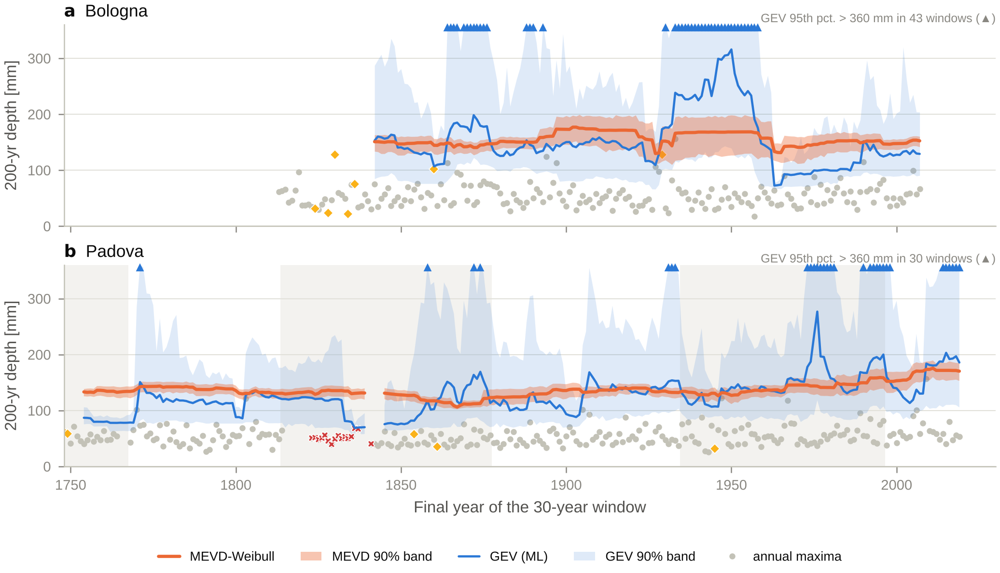
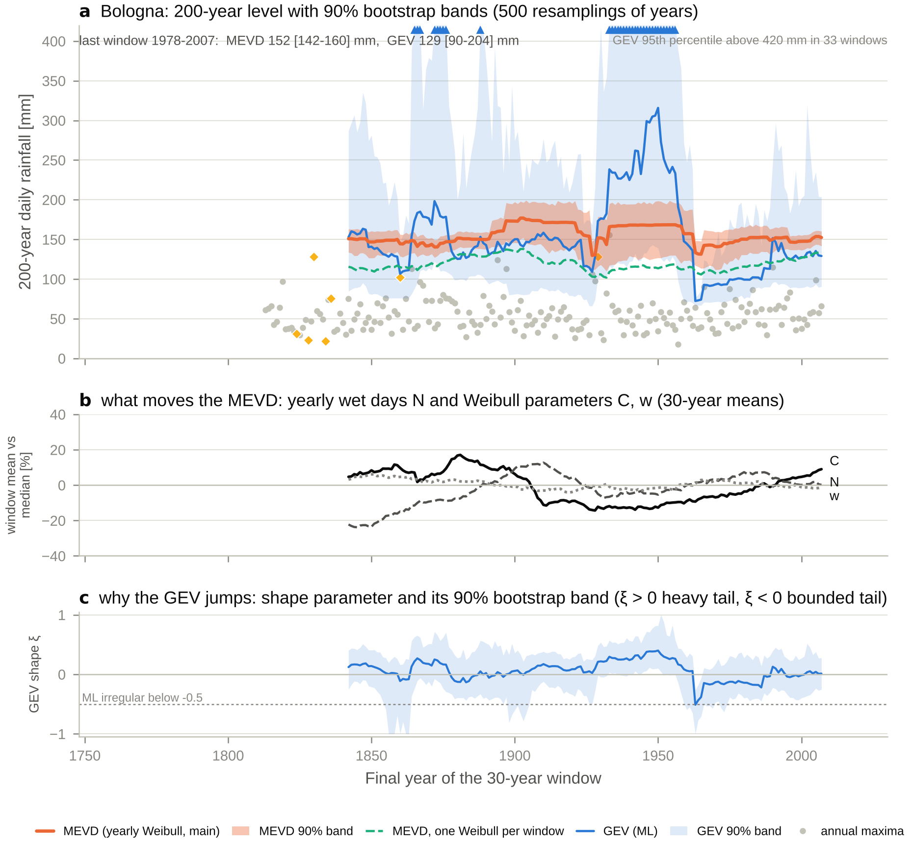
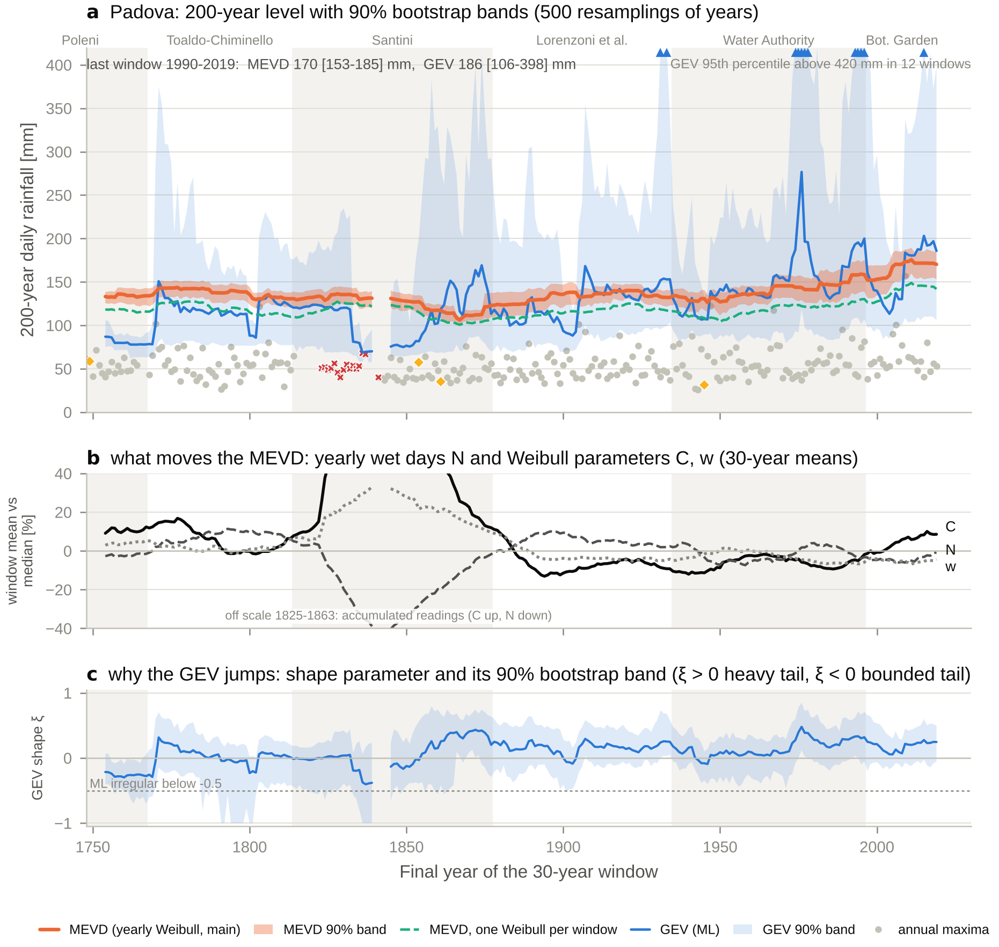
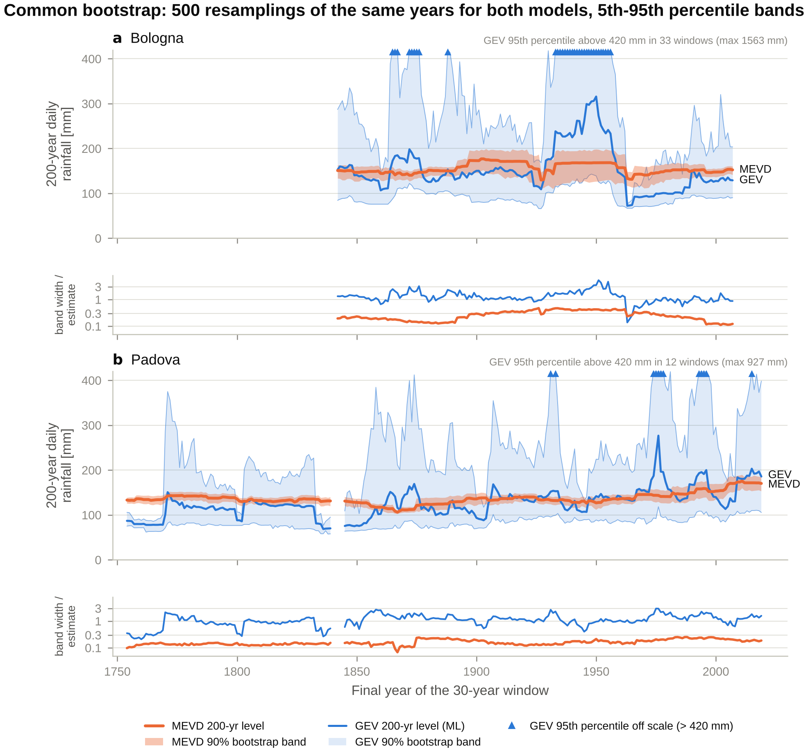
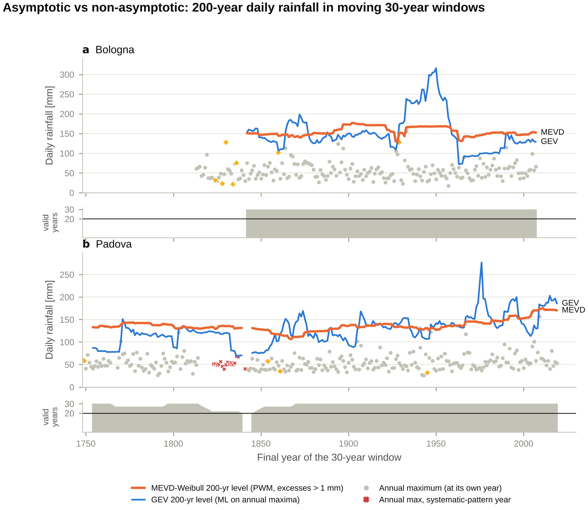
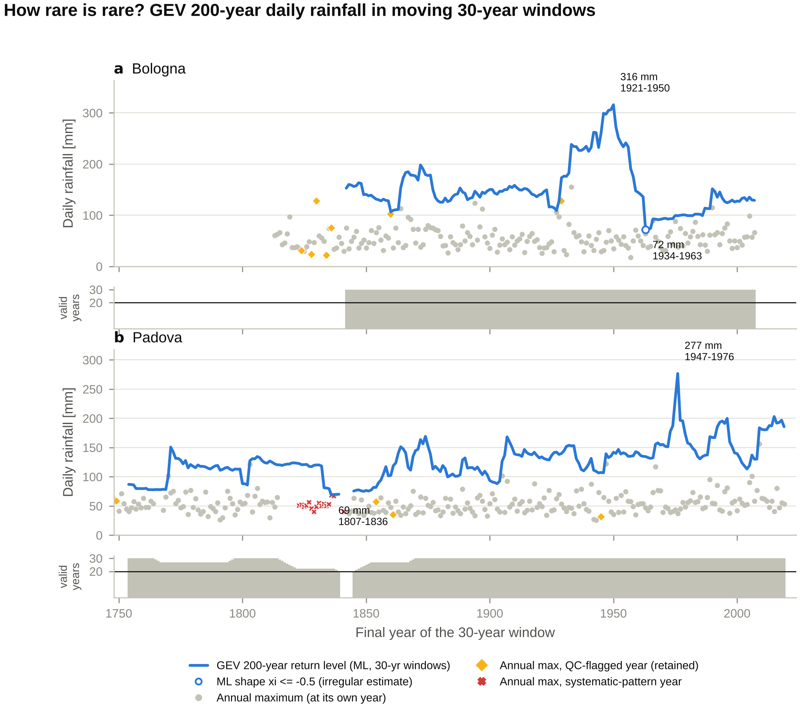

# How rare is rare? Moving-window extreme rainfall in Bologna and Padova

  

**GEV vs the non-asymptotic Metastatistical Extreme Value Distribution (MEVD-Weibull) on two of the longest daily rainfall records in the world.**

This repository estimates the **200-year daily rainfall depth** in sliding 30-year windows over the Bologna (1813–2007) and Padova (1725–2019) records. It asks how those estimates and their uncertainty change through time, whether the changes are shared by the two stations, and how they differ between:

* the classical **Generalized Extreme Value (GEV)** distribution fitted to annual maxima (block maxima, asymptotic extreme value theory), and
* the **MEVD-Weibull** (Marani & Ignaccolo, 2015; Zorzetto et al., 2016), which builds the distribution of annual maxima from *all* ordinary wet-day rainfall, year by year, without assuming an asymptotic limit.

Uncertainty comes from a **common non-parametric bootstrap**: 500 resamplings of whole years, with identical synthetic samples for both models. The daily analysis is a proving ground: the same machinery transfers to short sub-hourly gauge records and to the evaluation of convection-permitting climate models (CPMs), where records are typically only 10–30 years long.

📄 **Report (4 pages):** [PDF](docs/report/Beikahmadi_moving-window_rainfall_extremes_report.pdf) · [Word](docs/report/Beikahmadi_moving-window_rainfall_extremes_report.docx)

<p align="center">
  
</p>

## Key results

* **Stability.** Over the same windows the GEV 200-year daily depth spans 72–316 mm (Bologna) and 69–277 mm (Padova); the MEVD spans 130–177 and 106–176 mm. One year can halve the GEV estimate (Bologna: 136 → 72 mm when 24 February 1933 leaves the window).
* **Uncertainty.** With identical resampled years, MEVD 90% bands are 5–7 times narrower than GEV bands. Out of sample, the GEV 50-year level is exceeded about twice as often as expected (Padova 11 vs 5.3, p = 0.02); the MEVD level is not.
* **Caveats.** Nominal 90% bands under-cover in synthetic tests (GEV 80–85%, MEVD 68–74%), and for the MEVD the modelling choices (estimation window, Weibull estimator, formulation, recording resolution) move the estimate as much as or more than sampling noise.
* **Two stations.** Wet-day occurrence co-varies (year-to-year rank correlation 0.61), annual maxima barely (0.18): most changes of the 200-year level are station-specific. One change is shared: from 1948–1977 to 1978–2007 wet days became more intense at both stations (Weibull scale C +15% and +11%, 90% bootstrap intervals excluding zero), already before Padova's 1997 relocation.
* **Padova now.** The latest windows are Padova's highest (MEVD 170 mm [153–185] for 1990–2019), carried by heavier, not more frequent, wet days and not by the single 2009 storm.

## Project status

| # | Task | Script | Status |
|---|------|--------|--------|
| 1 | Data ingestion and quality control (both stations) | [`01_ingest_and_qc.py`](scripts/01_ingest_and_qc.py) | ✅ |
| 2 | 30-year moving windows + GEV 200-year levels | [`02_moving_window_gev.py`](scripts/02_moving_window_gev.py) | ✅ |
| 3 | MEVD-Weibull (wet day: P > 1 mm), verified against `mevpy` | [`03_moving_window_mev.py`](scripts/03_moving_window_mev.py) | ✅ |
| 4 | Common bootstrap (500 resamplings, 90% bands) + Monte Carlo check | [`04_bootstrap.py`](scripts/04_bootstrap.py) | ✅ |
| 5 | Results per station, sensitivity analyses, recent change, station comparison | [`05_results_and_sensitivity.py`](scripts/05_results_and_sensitivity.py) | ✅ |
| 6 | Interpretation and 4-page report | [`docs/report/`](docs/report/) | ✅ |

## Results in detail

### Results per station, sensitivity and comparison (Tasks 5–6)

<p align="center">
  
  
</p>

* **Bologna, then Padova** ([Fig. 21](outputs/figures/fig21_results_bologna.png), [Fig. 22](outputs/figures/fig22_results_padova.png)): 200-year levels with their 90% bands, the MEVD drivers (30-year means of N, C and w) and the GEV shape with its band. The GEV jumps follow its shape parameter; the MEVD follows its drivers.
* **Estimation window** ([Fig. 23](outputs/figures/fig23_estimation_window.png)). Fitting one Weibull to the wet days of 3, 5 or 30 pooled years (Miniussi & Marani, 2020), or the simplified MEV (Marra et al., 2019), removes the yearly-noise bias found in Task 4 and lowers the MEVD by 12–35 mm (median). Out of sample, however, Bologna's 50-year level is then exceeded 9–11 times instead of 3.7 (p ≤ 0.012), while Padova does not change (4 vs 5.3). Bologna's largest wet days are heavier-tailed than its bulk (Weibull shape of the top 25%: 0.77 vs 0.82, in every window), so the noise of yearly fits partly compensates a real tail that a single pooled Weibull misses. The yearly fit (main analysis, as in `mevpy`) is kept.
* **One choice at a time** ([Fig. 24](outputs/figures/fig24_sensitivity_summary.png); table `sensitivity_summary.csv`).
  * **GEV:** sampling dominates (median half-width of the 90% band 86 and 68 mm). The estimator, the QC screening and the window definition change the median window by about 1 mm; 20-year windows raise the coefficient of variation across Bologna windows from 0.32 to 0.53 (50 years: 0.18).
  * **MEVD:** modelling choices move the estimate as much as or more than sampling noise (half-width 18 and 10 mm): raw values instead of excesses (−29 / −24 mm, Bologna / Padova), ML instead of PWM (−26 / −11 mm), estimation window (−12 to −35 mm), a fit to the top 25% of wet days (−22 / −24 mm) and a 1 mm recording resolution (−13 mm at both stations). QC screening, window definition and window length (≤ 3.3 mm median) matter little.
  * The valid-year rule (5%, 10% or 20% of days missing) has no effect: data are missing in whole years. Reading Padova 1725–1764 in Paris instead of English inches (×1.066) raises the windows within that period by 6.6% (GEV) and 8% (MEVD).
* **Recent change and Bologna vs Padova** ([Fig. 25](outputs/figures/fig25_station_comparison.png)).
  * Year-to-year rank correlation over 184 common years: wet days N 0.61, annual totals 0.46, Weibull C and w 0.21, annual maxima 0.18. Occurrence is regional; extremes are largely station-specific (MEVD window series: 0.15).
  * Disjoint windows 1948–1977 → 1978–2007 (90% bootstrap intervals): C +15% [+8, +22] in Bologna and +11% [+4, +19] in Padova; N −4.5% [−10, +1] and −8% [−14, −2]. MEVD: Bologna +3% [−10, +19] (yearly fits; three heavy-tailed years hold up 1948–1977) and +17% [+2, +30] with one Weibull per window; Padova +21% [+3, +35]. The GEV intervals span −39% to +107% and wider.
  * Padova 1960–1989 → 1990–2019: MEVD +14% [−2, +29] (one Weibull per window: +14% [+2, +24]), C +18% [+11, +26], N −2% [−9, +6].
  * Padova's higher C is already present in 1978–1996, before the 1997 move of the station, and Bologna shows the same step: a regional signal is more likely than an instrumental one.

### Uncertainty: the common bootstrap (Task 4)

<p align="center">
  
</p>

* **Same resampled years for both models.** In every window the valid years are resampled with replacement 500 times. Each drawn year brings its annual maximum (GEV) and its (N, C, w) (MEVD), so the two models see identical synthetic samples. Bands are the 5th–95th percentiles.
* **GEV bands are 5–7 times wider than MEVD bands.** The median width of the 90% band relative to the estimate is 1.20 (GEV) vs 0.24 (MEVD) in Bologna, and 1.09 vs 0.15 in Padova. The GEV 95th percentile exceeds 420 mm in 33 Bologna and 12 Padova windows, and reaches 1563 mm.
* **A narrow GEV band can be falsely precise.** In Bologna 1934–1963 the GEV band is only 67–77 mm, one year after a 155.7 mm day was observed: the fitted tail is bounded, and resampling cannot create values the window does not contain ([Fig. 18](outputs/figures/fig18_bootstrap_distributions.png)).
* **One year shapes the GEV band.** A given year is missing from about 36% of the resamples ((1 − 1/30)^30). In Bologna 1933–1962 the GEV median is 72 mm when 1933 is not drawn, 139 mm with one copy, 178 mm with two and 252 mm with three or more; the MEVD moves from 132 to 188 mm. In Padova 1990–2019 the MEVD stays at 167–173 mm whether 2009 is drawn or not, while the GEV goes from 123 to 186 mm: the recent MEVD rise does not hinge on that single day.
* **Paired differences.** Because both models use the same resamples, the bootstrap distribution of GEV − MEVD is available for each window. The 90% band excludes zero in 18 of 166 Bologna and 32 of 261 Padova windows ([Fig. 19](outputs/figures/fig19_paired_difference_gev_mev.png)).
* **Do the bands mean what they say?** Synthetic 30-year records with a known true 200-year level were analysed with the same code, 500 records per case ([Fig. 20](outputs/figures/fig20_bootstrap_calibration.png)).
  * The nominal 90% GEV bands contain the truth 80–85% of the time, and miss mostly on the high side. This is consistent with Kyselý (2008, 2010).
  * The MEVD bands contain it 68–74% of the time, and miss mostly on the low side. The yearly-fit MEVD is biased high by about 13% at 200 years, but its total error is still about half that of the GEV (RMSE 21–24% vs 36–52%).
* **Why the MEVD is biased: yearly estimation noise.** When all years are identical, Weibull fits per year inflate the 200-year MEVD by 16–19%, while one Weibull fitted to all years is unbiased. About 75% (Bologna) and 41% (Padova) of the year-to-year scatter of the yearly shape *w* is estimation noise. This is the trade-off studied by Miniussi & Marani (2020) when choosing the estimation window. On the real records the noise effect partly compensates a real tail heavier than a single Weibull (Bologna), so the synthetic +16–19% is not a correction to apply (Tasks 5–6 above).
* **Engineering.** The 213,500 GEV refits use a vectorised Levenberg–Marquardt fitter with analytic gradient and Hessian ([`gev_batch.py`](src/rainfall_extremes/gev_batch.py)). It matches the reference fitter to within 6e-5 mm and runs the full bootstrap in about one minute.

### GEV vs MEVD (Task 3)

<p align="center">
  
</p>

* **MEVD is far more stable than GEV.** Its 200-year level stays within 130–177 mm in Bologna and 106–176 mm in Padova, against 72–316 mm and 69–277 mm for GEV.
  * Coefficient of variation across windows: 0.07 vs 0.32 (Bologna); 0.09 vs 0.25 (Padova).
  * Median change between consecutive windows: 0.2–0.4 mm vs about 3 mm.
* **Single years no longer dominate.** Removing Bologna's 1933 record day changes the MEVD by −15% (157 → 133 mm) but the GEV by −47% (136 → 72 mm). Adding Padova's 2009 day changes the MEVD by +2% and the GEV by +41%.
* **Out-of-sample check.** Each year was predicted from the other years of its 30-year window. GEV 50-year levels were exceeded 7 and 11 times, against 3.7 and 5.3 expected (Padova: binomial p = 0.02). MEVD 50-year levels were exceeded 3 and 4 times.
* **Verification.** The implementation matches `mevpy` to 6e-11 mm over all 427 windows ([`scripts/verify_mev_against_mevpy.py`](scripts/verify_mev_against_mevpy.py)).

### GEV in moving windows (Task 2)

<p align="center">
  
</p>

* **The GEV estimate of the 200-year daily rainfall depends heavily on which 30 years are in the window.**
  * Bologna: 72–316 mm (median 141 mm).
  * Padova: 69–277 mm (median 124 mm).
* **One value can halve it.** When Bologna's record day (155.7 mm, 24 Feb 1933) leaves the window, the 200-year level falls from 136 to 72 mm and the shape parameter flips from +0.06 to −0.51. The estimate for 1934–1963 is then half of a value observed one year earlier.
* **Reproduction of Marani & Zanetti (2015).** Using their conventions (maximum likelihood, 30-year windows indexed by start year, data to 2006), Padova's 200-year levels span 68.7–276.7 mm, against their "about 70 to almost 280 mm". The trend is 0.24 mm/yr against their "about 0.25 mm/year".
* **Verification.** The estimators agree with `mevpy` over all 261 Padova windows: L-moments to 1e-12, and the ML 200-year level to within 0.005 mm. Run [`scripts/verify_gev_against_mevpy.py`](scripts/verify_gev_against_mevpy.py) to check.

## Analysis specification

| Setting | Value | Source |
|---|---|---|
| Window | 30 calendar years, step 1 year | task |
| Window retained if | ≥ 20 valid years | task |
| Valid year | < 10% of days missing | Zorzetto et al. (2016) |
| Wet day | P **>** 1 mm | task |
| MEVD ordinary events | excesses over 1 mm; 1 mm added back to return levels | task / `mevpy` |
| Return period | 200 years, indexed to the **final** year of each window | task |
| Bootstrap | 500 resamplings of whole years, same years for GEV and MEVD; 5th–95th percentiles | task |
| GEV shape in bootstrap refits | restricted to [−1, 1]; interior maxima preferred; bound fits flagged | Smith (1985); see `gev_batch.py` |
| GEV estimator | maximum likelihood (main), L-moments (sensitivity) | Marani & Zanetti (2015) / `mevpy` |

All constants live in [`src/rainfall_extremes/config.py`](src/rainfall_extremes/config.py), together with the reason each was chosen.

## Data quality in one paragraph

Both records are long, but not homogeneous, and the quality-control pipeline ([`qc.py`](src/rainfall_extremes/qc.py)) flags what that means for extremes.

**Padova:**
* 14 documented missing years.
* A 1823–1837 (and 1841) period with half the usual number of wet days and heavier ones, while annual totals stay close to normal. This is the signature of multi-day amounts recorded on a single day.
* A 31-day block of 1748 repeated in 1749.
* Eight distinct recording resolutions, from 1/1000 English inch to 0.2 mm.

**Bologna:**
* Coarse 0.5–1 mm readings before 1880. These silently raise the effective wet-day threshold to about 1.5 mm.
* Three annual maxima (1830, 1860, 1929) that are isolated winter spikes after long dry spells, consistent with snow accumulation measured on one day.

Nothing is deleted on suspicion. Every analysis runs on the record **as provided** (main) and on a **QC-screened** version (sensitivity). See [`outputs/qc_report.md`](outputs/qc_report.md) after running Task 1.

## Repository layout

```
ordinary-to-extreme/
├── README.md
├── requirements.txt          # pip dependencies
├── environment.yml           # conda environment (Anaconda / Spyder)
├── pyproject.toml            # makes `rainfall_extremes` pip-installable
├── data/
│   ├── raw/                  # put the two assignment files here (not tracked)
│   └── processed/            # canonical daily + annual tables (generated)
├── src/rainfall_extremes/
│   ├── config.py             # every constant and threshold, documented
│   ├── plot_style.py         # shared figure style (colours, sizes, saving)
│   ├── metadata.py           # station metadata, Padova observer eras
│   ├── ingest.py             # raw files -> one canonical daily schema
│   ├── qc.py                 # QC checks, flags, scenarios, report
│   ├── qc_plots.py           # QC figures
│   ├── datasets.py           # access to processed tables
│   ├── windows.py            # calendar / consecutive moving windows
│   ├── gev.py                # GEV: L-moments, maximum likelihood, return levels
│   ├── moving_gev.py         # GEV over all windows, scenarios, estimators
│   ├── gev_plots.py          # Task 2 figures
│   ├── mev.py                # Weibull fits (PWM, ML, censored), MEVD cdf / quantiles
│   ├── moving_mev.py         # MEVD over all windows, configurations, GEV comparison
│   ├── validation.py         # leave-one-year-out calibration of GEV and MEVD
│   ├── mev_plots.py          # Task 3 figures
│   ├── gev_batch.py          # vectorised GEV maximum likelihood (bootstrap refits)
│   ├── bootstrap.py          # common bootstrap: same resampled years for both models
│   ├── coverage.py           # Monte Carlo check of the bootstrap bands
│   ├── bootstrap_plots.py    # Task 4 figures
│   ├── estimation_window.py  # MEVD with Weibull fits pooled over 1, 3, 5, 30 years; SMEV
│   ├── sensitivity.py        # one-at-a-time sensitivity of the 200-year level
│   ├── comparison.py         # disjoint-window change test, Bologna-Padova correlations
│   └── results_plots.py      # Task 5 figures and the report figures
├── scripts/
│   ├── 01_ingest_and_qc.py   # Task 1 driver (run with F5 in Spyder)
│   ├── 02_moving_window_gev.py
│   ├── 03_moving_window_mev.py
│   ├── 04_bootstrap.py       # ~3-4 min (bootstrap ~1 min, Monte Carlo check ~2 min)
│   ├── 05_results_and_sensitivity.py   # ~1 min
│   ├── verify_gev_against_mevpy.py
│   └── verify_mev_against_mevpy.py
├── outputs/
│   ├── figures/              # 300-dpi PNG + vector PDF
│   └── tables/               # all result tables (generated, not tracked)
├── tests/                    # pytest unit tests
└── docs/report/              # 4-page report (Word + PDF) and its build script
```

## Quick start

```bash
# 1. environment (Anaconda Prompt)
conda env create -f environment.yml
conda activate rainfall-extremes
pip install -e .            # optional: makes the package importable anywhere

# 2. data: copy the two assignment files, with their ORIGINAL names, into data/raw/

# 3. run the tasks in order
python scripts/01_ingest_and_qc.py
python scripts/02_moving_window_gev.py
python scripts/03_moving_window_mev.py
python scripts/04_bootstrap.py
python scripts/05_results_and_sensitivity.py
pytest                      # optional: unit tests

# 4. optional: rebuild the Word report from the figures (Node.js + npm package "docx")
node docs/report/build_report.js
```

**In Spyder:** open each script in `scripts/` in order and press **F5**. The script adds `src/` to the Python path itself, so `pip install -e .` is not required. Set `SHOW_FIGURES = True` at the top of the script to display the figures in the Plots pane.

## Data and licensing

The rainfall data are **not** redistributed here (see [`data/raw/README.md`](data/raw/README.md)).
* **Bologna:** NOAA NCEI Global Historical Climatology Network – Daily, station ITE00100550 (public domain).
* **Padova:** the historical daily series described by Marani & Zanetti (2015), provided for this exercise.

The code is released under the MIT licence.

## References

* Marani, M., & Ignaccolo, M. (2015). A metastatistical approach to rainfall extremes. *Advances in Water Resources*, 79, 121–126.
* Marani, M., & Zanetti, S. (2015). Long-term oscillations in rainfall extremes in a 268 year daily time series. *Water Resources Research*, 51, 639–647.
* Zorzetto, E., Botter, G., & Marani, M. (2016). On the emergence of rainfall extremes from ordinary events. *Geophysical Research Letters*, 43, 8076–8082.
* Zorzetto, E. `mevpy`: Python implementation of the MEVD. https://github.com/EnricoZorzetto/mevpy
* Greenwood, J. A., Landwehr, J. M., Matalas, N. C., & Wallis, J. R. (1979). Probability weighted moments. *Water Resources Research*, 15(5), 1049–1054.
* Kyselý, J. (2008). A cautionary note on the use of nonparametric bootstrap for estimating uncertainties in extreme-value models. *Journal of Applied Meteorology and Climatology*, 47, 3236–3251.
* Kyselý, J. (2010). Coverage probability of bootstrap confidence intervals in heavy-tailed frequency models, with application to precipitation data. *Theoretical and Applied Climatology*, 101, 345–361. https://doi.org/10.1007/s00704-009-0190-1
* Miniussi, A., & Marani, M. (2020). Estimation of daily rainfall extremes through the metastatistical extreme value distribution: uncertainty minimization and implications for trend detection. *Water Resources Research*, 56, e2019WR026535. https://doi.org/10.1029/2019WR026535
* Marra, F., Zoccatelli, D., Armon, M., & Morin, E. (2019). A simplified MEV formulation to model extremes emerging from multiple nonstationary underlying processes. *Advances in Water Resources*, 127, 280–290. https://doi.org/10.1016/j.advwatres.2019.04.002
* Marra, F., Borga, M., & Morin, E. (2020). A unified framework for extreme subdaily precipitation frequency analyses based on ordinary events. *Geophysical Research Letters*, 47, e2020GL090209. https://doi.org/10.1029/2020GL090209
* Smith, R. L. (1985). Maximum likelihood estimation in a class of nonregular cases. *Biometrika*, 72(1), 67–90.
* Camuffo, D. (1984). Analysis of the series of precipitation at Padova, Italy. *Climatic Change*, 6, 57–77. https://doi.org/10.1007/BF00141668
* Camuffo, D., della Valle, A., Becherini, F., et al. (2020). Three centuries of daily precipitation in Padua, Italy, 1713–2018: history, relocations, gaps, homogeneity and raw data. *Climatic Change*, 162, 923–942. https://doi.org/10.1007/s10584-020-02717-2
* della Valle, A., Camuffo, D., Becherini, F., et al. (2023). Recovering, correcting, and reconstructing precipitation data affected by gaps and irregular readings: the Padua series from 1812 to 1864. *Climatic Change*, 176, 9. https://doi.org/10.1007/s10584-023-03485-5

## Acknowledgements

The MEVD formulation follows the reference implementation `mevpy` by Enrico Zorzetto. The functions used here were re-implemented for current Python and adapted to the moving-window design of this study, and they are verified numerically against `mevpy` (Task 3).

---
*Author: Niloufar Beikahmadi. Prepared as an applicant exercise for the Research Center on Climate Change Impacts (CRITICAL), University of Padova.*
